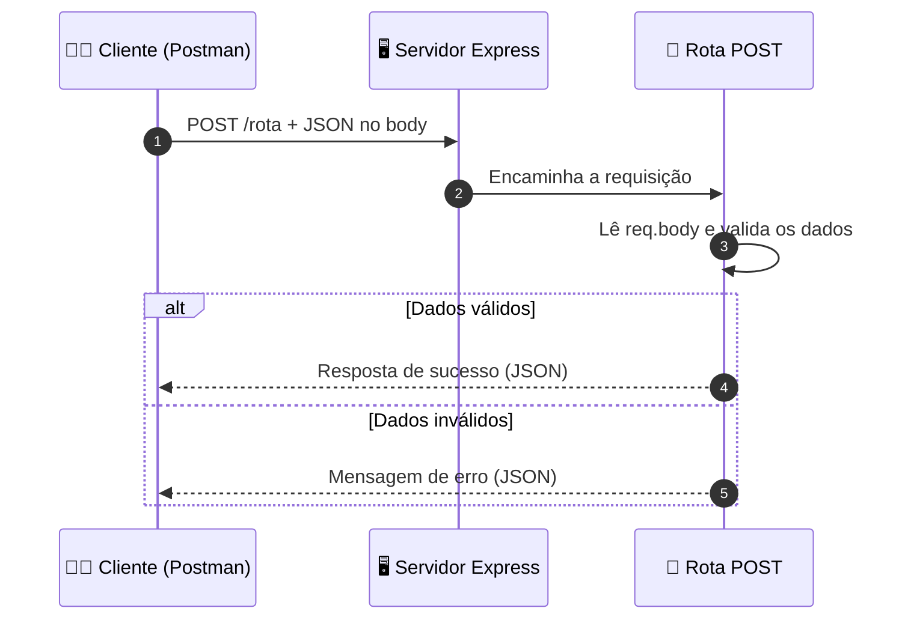
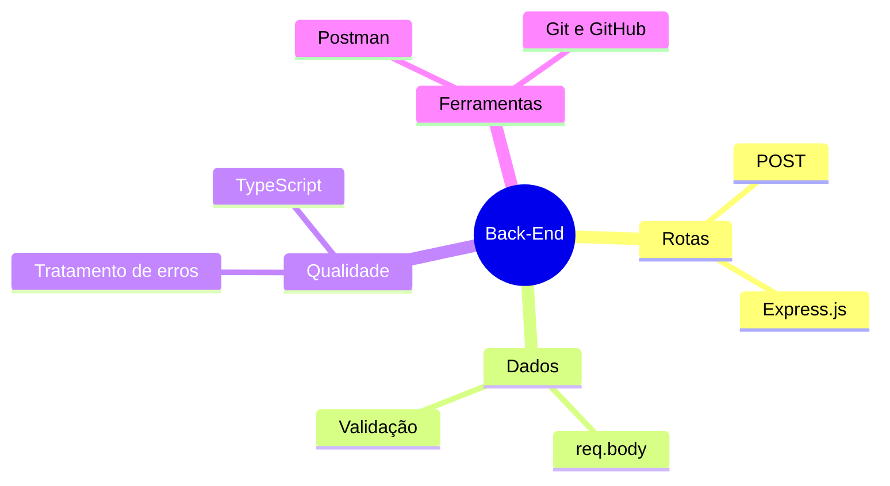

# atividade-express-post
<div align="center">


<a href="https://git.io/typing-svg">
  
</a>

<br/>


</div>

---

## 🧭 Navegação rápida

<div align="center">

| | | |
|:---:|:---:|:---:|
| [📘 Sobre](#-sobre-o-projeto) | [🎯 Objetivos](#-objetivos) | [🛠️ Tecnologias](#️-tecnologias-utilizadas) |
| [🧩 Atividades](#-atividades-desenvolvidas) | [🗂️ Estrutura](#️-estrutura-do-projeto) | [⚙️ Como executar](#️-como-executar-o-projeto) |
| [🧪 Postman](#-testes-com-postman) | [🎓 Aprendizados](#-aprendizados) | [👩‍💻 Autora](#-autora) |

</div>

---

## 📘 Sobre o projeto

Este repositório reúne atividades práticas criadas para **aprender e aplicar os conceitos de criação de APIs** com **Node.js**, **TypeScript** e o framework **Express.js**.

Foram implementadas rotas do tipo **POST**, que recebem informações enviadas pelo cliente no corpo da requisição (*body*), processam os dados e devolvem respostas em **JSON**.

A atividade também trabalha:

- 🗃️ organização de projetos
- 🛡️ tratamento de erros
- ✅ validação de informações
- 🧪 testes de requisições com o Postman

> 💡 **Resumo em uma linha:** o cliente envia dados → a API valida e processa → devolve uma resposta em JSON.

### 🔄 Como funciona o fluxo de uma requisição POST



---

## 🎯 Objetivos

<details open>
<summary><b>📌 Clique para abrir ou fechar a lista de objetivos</b></summary>
<br/>

- [x] Compreender o funcionamento do protocolo HTTP e do método POST
- [x] Criar e configurar um servidor utilizando Express.js
- [x] Desenvolver rotas para receber e processar informações
- [x] Trabalhar com requisições e respostas utilizando TypeScript
- [x] Utilizar o `req.body` para acessar os dados enviados pelo cliente
- [x] Implementar validações e tratamento de possíveis erros
- [x] Testar endpoints utilizando o Postman
- [x] Praticar a organização e o versionamento de código com Git e GitHub

</details>

---

## 🛠️ Tecnologias utilizadas

| Tecnologia | Finalidade |
|:---|:---|
|  | Ambiente de execução JavaScript |
|  | Tipagem estática e desenvolvimento do código |
|  | Criação do servidor e gerenciamento de rotas |
|  | Testes das requisições HTTP |
|  | Controle de versão |
|  | Armazenamento e compartilhamento do projeto |

---

## 🧩 Atividades desenvolvidas

> 👇 Clique em cada atividade para ver os detalhes.

<details>
<summary><b>🔹 Atividade 01 – Rota <code>POST /mensagem</code></b></summary>
<br/>

Rota que recebe **três informações** no corpo da requisição:

| Campo | Descrição |
|:---|:---|
| `nome` | Nome da pessoa |
| `idade` | Idade da pessoa |
| `time` | Time favorito |

Com os dados recebidos, a API **constrói uma frase personalizada** e a retorna ao cliente.


**Exemplo de requisição (JSON):**

```json
{
  "nome": "Anna",
  "idade": 16,
  "time": "Corinthians"
}
```

</details>

<details>
<summary><b>🔐 Atividade 02 – Rotas POST de autenticação</b></summary>
<br/>

Estrutura de autenticação por meio de uma rota POST, que recebe as informações necessárias para **verificar um login**.

O exercício pratica:

- 📥 recebimento de dados
- ✅ validação das informações enviadas
- 💬 retorno de mensagens de sucesso ou erro


</details>

<details>
<summary><b>🎮 Atividade 03 – Rotas POST com Player</b></summary>
<br/>

Rotas para realizar operações relacionadas a um jogador (*Player*), trabalhando com **informações e regras de negócio**.

A atividade pratica:

- 📥 recebimento de dados
- 🧮 manipulação das informações do jogador
- ⚠️ tratamento de situações inválidas

As operações são organizadas em **endpoints específicos**, de acordo com a implementação do projeto.

</details>

---

## 🗂️ Estrutura do projeto

A organização dos arquivos facilita a manutenção e a compreensão do código.

```text
atividade-express-post/
│
├── 📁 src/
│   ├── 📄 app.ts
│   │
│   ├── 📁 models/
│   │
│   └── 📁 routes/
│
├── 📄 package.json
├── 📄 package-lock.json
├── 📄 tsconfig.json
└── 📄 README.md
```

> ℹ️ *A estrutura pode variar conforme a organização final dos três exercícios.*

---

## ⚙️ Como executar o projeto

É necessário ter o **Node.js** instalado.

<details open>
<summary><b>🚀 Passo a passo</b></summary>
<br/>

**1️⃣ Clone o repositório**

```bash
git clone URL_DO_REPOSITORIO
```

**2️⃣ Entre na pasta do projeto**

```bash
cd atividade-express-post
```

**3️⃣ Instale as dependências**

```bash
npm install
```

**4️⃣ Execute o servidor**

```bash
npm run dev
```

✅ Com o servidor rodando, já é possível fazer as requisições pelo **Postman**.

</details>

---

## 🧪 Testes com Postman

Os testes foram feitos no **Postman**, ferramenta que envia requisições HTTP e mostra as respostas da API.

<details>
<summary><b>📋 Ver o passo a passo dos testes</b></summary>
<br/>

1. Inicie o servidor pelo terminal.
2. Abra o Postman.
3. Selecione o método **POST**.
4. Informe o endereço da rota desejada.
5. Acesse a opção **Body**.
6. Selecione **raw** e escolha o formato **JSON**.
7. Insira os dados necessários.
8. Clique em **Send** para enviar a requisição.
9. Verifique a resposta e o código de status retornado.

</details>

<details>
<summary><b>💻 Prefere o terminal? Exemplo com cURL</b></summary>
<br/>

Teste da Atividade 01 (ajuste a porta conforme o seu projeto):

```bash
curl -X POST http://localhost:PORTA/mensagem \
  -H "Content-Type: application/json" \
  -d '{"nome": "Anna", "idade": 16, "time": "Corinthians"}'
```

</details>

---

## 🎓 Aprendizados

Com esta atividade foi possível entender melhor como funciona a **comunicação entre cliente e servidor** por meio de requisições HTTP.



Também foram praticados conceitos importantes do desenvolvimento **Back-End**:

- 🛣️ criação de rotas
- 📦 recebimento de dados pelo `req.body`
- ⚡ uso do Express.js
- 🔷 tipagem com TypeScript
- 🛡️ tratamento de erros

Os exercícios ajudaram a desenvolver a **lógica de programação** e a entender como uma API recebe informações, executa operações e devolve respostas ao cliente.

---

## 🏁 Considerações finais

A atividade foi importante para aprofundar os conhecimentos sobre desenvolvimento de APIs com **Express.js** e **TypeScript**. Na prática, foram trabalhadas a criação de rotas POST, a manipulação de dados enviados pelo cliente e a realização de testes com o Postman.

Além disso, o desenvolvimento contribuiu para melhorar a **organização do código**, a **identificação de erros** e a compreensão da comunicação entre aplicações. Esses conhecimentos são fundamentais para seguir avançando no desenvolvimento Back-End e na construção de aplicações mais completas.

---

## 👩‍💻 Autora

<div align="center">

**Anna Beatriz Rufino De Araújo**


<br/>

⭐ *Se este projeto te ajudou, deixe uma estrela no repositório!* ⭐


</div>
